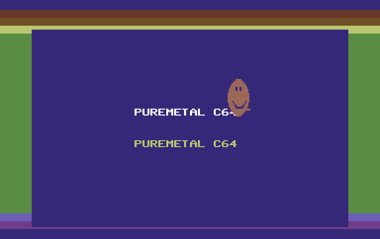
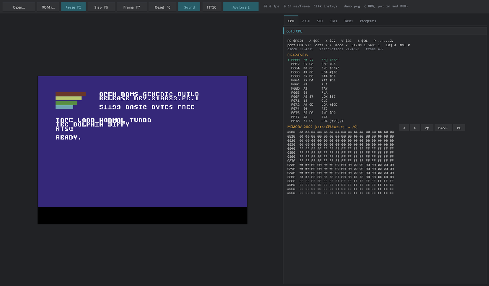
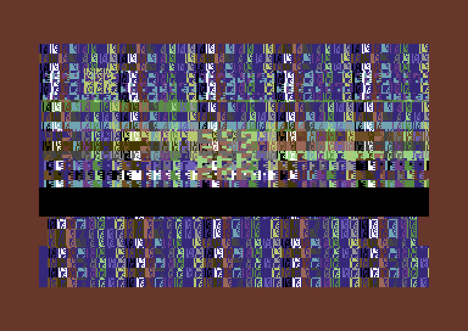

# PureMetal C64 for the Raspberry Pi Pico series

A Commodore 64 emulator for the Raspberry Pi Pico W and Pico 2 W, written in PureMetal and compiled
with PureMetal Forge to bare-metal machine code: no SDK, no RTOS. The picture goes to a LAFVIN ST7796
panel, the SID to a Bluetooth speaker (optional), and the kit's stick and buttons are the joystick.
The same machine source also builds a Windows program, drawn with the Neon Arcade Display Engine, with
the PC keyboard as the C64's, sound through the PC and debug panes for the CPU, VIC-II, SID and CIAs.

It starts as the **NTSC C64** (the US machine: 60 frames a second); PAL is one command away.

**No ROMs or games are included.** The C64's BASIC, KERNAL and character ROMs are copyrighted: bring
your own (see [ROMs and disks](#roms-and-disks)). Without them the firmware runs a built-in demo of
this project's own.



## Features

| Part | What it does |
|---|---|
| 6510 | every NMOS opcode, the undocumented ones included, cycle-counted (page crossings, taken branches), the read-modify-write double write, the I/O port at $00/$01; on the RP2350 the dispatch and operand fetches are Thumb-2 |
| PLA | LORAM / HIRAM / CHAREN and the cartridge's EXROM / GAME: every memory configuration, Ultimax included; RAM under every ROM |
| VIC-II | NTSC (6567: 263 lines of 65 cycles) and PAL (6569: 312 of 63), line by line with the chip's own badline / display / idle logic (VC, VCBASE, RC); text, multicolour text, extended-colour, bitmap and multicolour bitmap; X/Y scroll, 38/40 columns, 24/25 rows; the vertical border flip-flop (open borders work); 8 sprites with expansion, multicolour, priority and both collisions; raster IRQ; badlines and sprite DMA take their cycles from the CPU |
| CIA x2 | both timers (one-shot, continuous, B counting A), exact to the cycle at every register access; TOD with alarm (50 / 60 Hz); ICR and masks; IRQ (CIA 1) and NMI (CIA 2); the keyboard matrix both ways; both joystick ports; CIA 2's VIC bank |
| SID | 3 voices: triangle, saw, pulse, noise and their combinations, hard sync, ring modulation, the real envelope rate table with its exponential decay, a state-variable filter (low / band / high pass, cutoff, resonance), the volume's DC offset (so $D418 digis play) |
| Loading | a .PRG put straight into RAM (BASIC pointers set, RUN typed); a .D64 in drive 8 through a trap on the KERNAL's LOAD: wildcards, `LOAD"$",8`, `,8,1` |

Not yet: a real 1541 (fast loaders that drive the disk themselves), .CRT cartridges, tape.

## Boards

| Board | Chip | Panel | Audio | Status |
|---|---|---|---|---|
| Raspberry Pi Pico W | RP2040, 200 MHz | LAFVIN ST7796 480 x 320 (SPI 100 MHz) | Bluetooth A2DP speaker | tested on the board |
| Raspberry Pi Pico 2 W | RP2350, 150 MHz | LAFVIN ST7796 480 x 320 (SPI 75 MHz) | Bluetooth A2DP speaker | tested on the board (picture, speed, CPU tests); speaker not yet |

Wiring is the LAFVIN kit's: LCD SCK GP2, MOSI GP3, CS GP5, DC GP6, RST GP7 (SPI0); analog stick
GP26 / GP27; button A GP15 (fire), button B GP14 (SPACE).

**Both cores work.** Core 0 runs the 6510, both CIAs, the SID and the VIC-II's line logic, and leaves
each visible line as a record; core 1 draws the records (cells, sprites, borders, collisions),
converts them to RGB565 in the chip's own assembly and sends them to the panel by DMA, and drives the
radio. When the panel's link falls behind, the panel skips a frame but the machine never does: every
frame is still drawn, so sprite collisions stay exact.

## Measured

Frames a second for the machine / the panel, and each core's working time, on the boards (no frame
late in any of these runs):

| Board | Standard | Program | Frames/s | Worst frame | Core 0 busy | Core 1 busy |
|---|---|---|---:|---:|---:|---:|
| Pico W | NTSC | BASIC, self-test, PureMetal demo | 60 / 60 | 12.4 ms | 57-60% | 61-63% |
| | NTSC | a SEUCK shoot-'em-up from a .D64, in play | 60 / 57-58 | 14.8 ms | 69-82% | 61-63% |
| | PAL | all of the above | 51 / 51 | 16.0 ms | 56-80% | 58-60% |
| Pico 2 W | NTSC | all of the above | 60 / 44-45 | 13.8 ms | 57-82% | 48-54% |
| | PAL | all of the above | 51 / 38 | 18.9 ms | 56-96% | 46-49% |

On the Pico 2 W the panel's link is the limit: the RP2350 runs at its rated 150 MHz, so SPI0 runs at
75 MHz and a 384-pixel line takes 82 us - about 50 frames a second NTSC and 45 PAL at most. (Its PAL
row was measured with the SID at 48 kHz; it now runs at 24 kHz on both boards.)

The 6510 on Wolfgang Lorenz's CPU tests (140 tests, 608 million instructions), all passing:

| Board | 6510 core | Instructions a second |
|---|---|---:|
| Pico W | Thumb-1 (`src/cpu6510.pmi`) | 1.60 M |
| Pico 2 W | the same core | 1.49 M |
| Pico 2 W | Thumb-2 (`src/cpu6510_m33.pico2`) | 1.88 M |

A real C64 runs about 0.3 million instructions a second. Logs: `docs/board-*.log`, `docs/lorenz-*.log`.

## Quick start

1. Download the firmware for your board: `firmware/c64-pico-w.uf2` (Pico W) or
   `firmware/c64-pico2-w.uf2` (Pico 2 W).
2. Hold the board's BOOTSEL button while you plug it into USB; it appears as a drive.
3. Drag the `.uf2` onto the drive. The board restarts into the emulator and runs the built-in demo.
4. Put your ROMs (and programs or disks) into its flash store - next section - and it boots to BASIC.

A terminal on the board's USB serial port (115200, any program) is the C64's keyboard; lines
starting with a backtick are commands:

| Command | What it does |
|---|---|
| any text | typed on the C64's keyboard (Enter is RETURN) |
| `` `v `` | NTSC <-> PAL (NTSC is the default); the program starts again |
| `` `b `` | boot BASIC (needs the ROMs in the store) |
| `` `d `` | the built-in demo |
| `` `r `` | reset |
| `` `0 ``-`` `9 `` | put the store's first ... tenth .PRG in and RUN it |
| `` `l `` | type `LOAD"*",8,1` and RUN (the store's .D64 is drive 8) |
| `` `s `` | print the screen's text |
| `` `j `` `` `u `` `` `n `` `` `a `` `` `e `` | joystick fire / up / down / left / right for 0.2 s |
| `` `m `` | mute |
| `` `p `` | add the time split (CPU / VIC / SID) to the status line |

The board prints a status line once a second: frames, emulation time, panel frames and skips,
each core's working time.

## ROMs and disks

You need the C64's three ROMs, from a C64 you own or a licensed source (for example the ROM files that
come with Cloanto's C64 Forever):

| ROM | Size | File name must contain |
|---|---|---|
| BASIC | 8192 bytes | `basic` |
| KERNAL | 8192 bytes | `kernal` |
| Character | 4096 bytes | `char` (or the part number `901225`) |

Free replacement ROMs exist (the MEGA65 project's Open ROMs, under their own licence); they boot this
emulator but are not fully compatible with every program. The disk loader works with Commodore's
KERNAL and, through the KERNAL's jump table, with the Open ROMs.

Pack the ROMs, any .PRG programs and a .D64 disk into the C64's flash region ($1F0000, 60 KB) and
write it to the board (the board must be running the emulator, on its USB serial port):

```
py -3 tools/c64_store.py --roms <your ROM folder> --prg game.prg --d64 disk.d64 -o build/c64-store.bin
PureMetalForge.exe --storage-write build\c64-store.bin --offset $1F0000 -t rp2040 --port COM7
```

Use `-t rp2350` for a Pico 2 W. A .D64 is stored sparse (only the sectors in use), so a disk with one
or two games fits. The emulator boots BASIC whenever the store holds the three ROMs.

## Sound

The SID is synthesised at 24 kHz and sent as 48 kHz A2DP (SBC) to a Bluetooth speaker. The speaker's
address is private, so the published firmware is silent. To hear it, build a wrapper of your own
(keep it out of version control):

```
; my-c64.picow - the C64 with my speaker
#C64_AUDIO = 1
EnableExplicit
XIncludeFile "<repo>/src/platform_rp2040.pico"
XIncludeFile "<repo>/src/libs_rp2040.pico"
XIncludeFile "<repo>/src/c64_app.pmi"
DataSection
MySpeaker:
  Data.a $11, $22, $33, $44, $55, $66   ; 11:22:33:44:55:66, in the order written
EndDataSection
C64BluetoothSetPeer(?MySpeaker)
C64Main()
```

The first connection pairs with the speaker and saves its link key in the flash's last sector.

## Building from source

You need PureMetal Forge (the PureMetal compiler) from 2026-10-25 or later (main 341fd5aca was used for
the measurements above). From PowerShell:

```
PureMetalForge.exe --compile src\c64.picow  -S -o firmware\c64-pico-w.uf2
PureMetalForge.exe --compile src\c64.pico2w -S -o firmware\c64-pico2-w.uf2
```

Add `--port COM7` to upload after building. Generated sources come from scripts in `tools/` and
reproduce byte for byte:

| Script | Writes |
|---|---|
| `tools/gen_cpu.py` | the 6510 for the Pico (`src/cpu6510.pmi`) and the desktop (`desktop/core/cpu6510.pbi`), from one opcode table |
| `tools/gen_cpu_m33.py` | the RP2350's 6510, `src/cpu6510_m33.pico2` (run after gen_cpu.py) |
| `tools/port_desktop.py` | the desktop's copy of the machine (`desktop/core/*.pbi`) from `src/*.pmi` |
| `tools/make_demo.py` | the built-in demo, `tests/demo.prg` and `src/demo_data.pmi` (needs `py65`) |
| `tools/make_modes.py`, `tools/make_selftest.py` | the VIC-II mode picture and the machine self-test |
| `tools/make_pm_demo.py` | `demo/c64demo.c64`, the demo written in PureMetal |
| `tools/controls_readme.py` | the README's Controls section, from `desktop/controls.pbi` |

## The desktop version



### Building the desktop version

You need PureBasic 6.41 for Windows x64 (the C back end) and the
[Neon Arcade Display Engine](https://github.com/ajtaji/Neon-Arcade-Dispay-Engine), cloned beside this
repository - the program finds it at `../Neon-Arcade-Dispay-Engine/` next to its own folder:

```
git clone https://github.com/ajtaji/C64EmulatorPicoSeries.git
git clone https://github.com/ajtaji/Neon-Arcade-Dispay-Engine.git
```

Then, from PowerShell in the folder that holds both:

```
& "C:\Program Files\PureBasic\Compilers\pbcompilerc.exe" C64EmulatorPicoSeries\desktop\c64_desktop.pb /EXE C64EmulatorPicoSeries\desktop\PureMetalC64.exe /THREAD /DPIAWARE /OPTIMIZER
C64EmulatorPicoSeries\desktop\PureMetalC64.exe [program.prg | disk.d64] [--roms <folder>] [--pal] [--mute]
```

With the engine somewhere else, add `/CONSTANT GL_ENGINE_DIR$=<path to the engine>/` (the trailing slash
matters). The console check builds the same way: `desktop\c64_check.pb` with `/CONSOLE` (it needs no engine).

Choose the ROM folder once with the toolbar's **ROMs...** (it is remembered). It starts as the NTSC
C64; the toolbar's NTSC / PAL button or `--pal` switches.

### Controls

The same table drives the keyboard code, the program's **Controls** tab and this section
(`desktop/controls.pbi`; `py -3 tools/controls_readme.py` rewrites it here, `--check` compares).

<!-- controls: generated by tools/controls_readme.py from desktop/controls.pbi -->

| C64 keyboard | |
|---|---|
| A-Z, 0-9, Space, Return | the same keys |
| Esc (in the window) | RUN/STOP |
| End | RUN/STOP |
| Page Up | RESTORE |
| Left Ctrl | C= (Commodore) |
| Tab | CTRL |
| Left Shift | LEFT SHIFT |
| Right Shift | RIGHT SHIFT |
| Home | CLR/HOME |
| Backspace | INST/DEL |
| Insert | + |
| Delete | up arrow |
| Right (joystick keys off) | CRSR right |
| Left (joystick keys off) | CRSR left (SHIFT + CRSR right) |
| Down (joystick keys off) | CRSR down |
| Up (joystick keys off) | CRSR up (SHIFT + CRSR down) |
| F1 | f1 |
| F2 | f2 (SHIFT + f1) |
| F3 | f3 |
| F4 | f4 (SHIFT + f3) |
| Keypad 5 | f5 |
| Keypad 7 | f7 |
| - | + |
| = | - |
| [ | @ |
| ] | * |
| ; | : |
| ' | ; |
| , | , |
| . | . |
| / | / |
| \\ | pound |
| \` | left arrow |

| Joystick and gamepad | |
|---|---|
| Up | joystick up |
| Down | joystick down |
| Left | joystick left |
| Right | joystick right |
| Right Ctrl | joystick fire |
| Right Alt | joystick fire |
| Gamepad stick / d-pad | joystick directions |
| Gamepad button 1 or 2 | joystick fire |

| The window | |
|---|---|
| F5 | run / pause |
| F6 | step one instruction |
| F7 | step one frame |
| F8 | reset |
| F11 | full screen on / off |
| Esc (in full screen) | leave full screen |

<!-- controls end -->

**Full screen** (the toolbar's button or F11): a borderless window over the monitor the window is on - no
display-mode change - showing only the C64's picture, border included, at the standard's real pixel
aspect (PAL 0.9365, NTSC 0.75), as large as fits and centred on black. Esc leaves and the window comes
back exactly where and as large as it was. In full screen Esc is not passed to the C64, so RUN/STOP is
End there (End is RUN/STOP in the window too). F11 is free: the C64's function keys are F1-F4 and keypad
5 / 7. The pointer hides after two idle seconds.

Panes: CPU (registers, disassembly, memory), VIC-II, SID (voices and the output), CIAs (timers, TOD,
keyboard matrix), Tests (Lorenz's CPU tests on the running machine, if you have them), Programs, Controls.

`PureMetalC64.exe --pointer-test <log>` checks that the pointer and the controls agree at the display's
scale without touching the real pointer: it drives the window with synthetic positions - four points on
each of 21 controls, from the toolbar at the top to the program list's last row at the bottom - writes
each result to `<log>` and exits with the number of failures (at 125%: 84 of 84, read back within
0.5 px).

`PureMetalC64.exe --fullscreen-test <log> [<shot.bmp>]` checks full screen with posted F11 / Esc key
messages and no real input: Esc is RUN/STOP in the window, F11 covers the window's monitor with the
picture at the standard's shape, as large as fits and centred, the machine runs at its frame rate, Esc
and End do what the table says, Esc leaves and the window's rectangle and style come back exactly - in
NTSC, then PAL. It exits with the number of failures (30 of 30 on a 1920 x 1080 monitor at 125%).

`desktop\c64_check.exe` (from `desktop\c64_check.pb`, `/CONSOLE`) is the console check:
`--bench [test]`, `--demo [--prg f]`, `--boot <romdir> [--prg f] [--d64 f] [--type text] [--frames n]
[--shot f.bmp] [--wav f.wav] [--joy frame:mask] [--ntsc]`. It runs PAL unless `--ntsc`: its reference
pictures are PAL.

## Testing



- **The machine checks itself:** `tests/selftest.prg` (from `tools/make_selftest.py`) runs with no
  KERNAL code and prints one line each: PLA banking, keyboard matrix, CIA 1 timer A and its timing, TOD,
  raster IRQ, sprite-sprite and sprite-background collisions, badline cycle stealing, SID OSC3 / ENV3
  and a CIA 2 timer NMI. All pass on the desktop (bare and RUN from BASIC) and on the Pico W, NTSC and PAL.
- **The 6510:** Wolfgang Lorenz's C64 Emulator Test Suite 2.15 is not included; get it from the
  VICE project's test programs and put its files in `tests/lorenz/`. Then `tools/embed_lorenz.py`
  builds the board tests (`src/tests/lorenzN.picow` / `.pico2w`) and `c64_check --bench` runs it on the
  desktop. Every CPU test (238, `start` to `trap17`) passes on the desktop and on the Pico W, with the
  same instruction counts; batch 1 also on the Pico 2 W with both 6510 cores. `cputiming`, `cpuport`,
  `icr01`, `oneshot`, `loadth`, `cntdef`, `cia1tb123` and `cia2tb123` pass on the whole machine.
- **The renderer:** every change to the VIC-II or the SID is compared on the desktop against the build
  before it, pixel for pixel and sample for sample (`tests/modes.prg`, both demos, a game in play).
- **The panel converter** checks itself at boot against the palette (`vid565=ok` in the status line).

## Known limits

- No real 1541: programs whose loader drives the disk drive directly do not load (the KERNAL's LOAD does).
- The VIC-II is drawn a line at a time at cycle 14: effects that change registers in the middle of a
  line (some demo tricks) show from the next line. On a Pico the drawing reads character and bitmap
  memory a few lines after the real chip would.
- Several of Lorenz's single-cycle CIA and interrupt tests still fail (`docs/bench-desktop-cia.log`).
- The Pico 2 W's panel shows about 45 frames a second (see above); the machine still runs at full speed.

## A demo written in PureMetal

`demo/` holds a C64 program written in PureMetal and compiled by PureMetal Forge for its Commodore 64
board: raster bars, a smooth scroller, a bouncing sprite and three SID voices. It runs on a real C64 as
well as here (`demo/README.md`).

## Repository layout

```
src/        the machine (src/*.pmi, shared by both chips and the desktop) and the Pico side
            (panel, audio, controls, flash store, the per-chip 6510 and converter)
desktop/    the Windows program, its console check and the generated machine copy (desktop/core)
firmware/   ROM-free firmware images
demo/       the demo written in PureMetal
tests/      the project's own test programs (demo, VIC-II modes, self-test, raster split) and the
            board scripts (tests/board/)
tools/      generators, the flash-store packer, board scripts
docs/       measurement logs and notes
```

## Credits and licences

MIT (see `LICENSE`). No third-party code is included. The 6510's undocumented opcodes follow the
public documentation of the NMOS 6502 family; the VIC-II's timing follows Christian Bauer's article
"The MOS 6567/6569 video controller (VIC-II) and its application in the Commodore 64"; the palette is
Philip "Pepto" Timmermann's measurement of the PAL VIC-II's colours.
